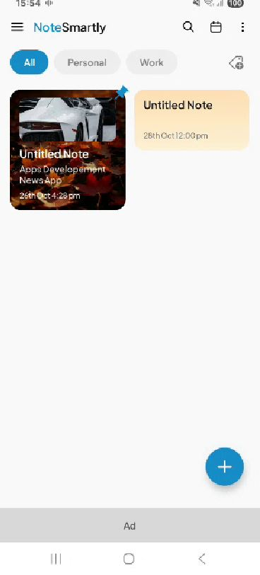
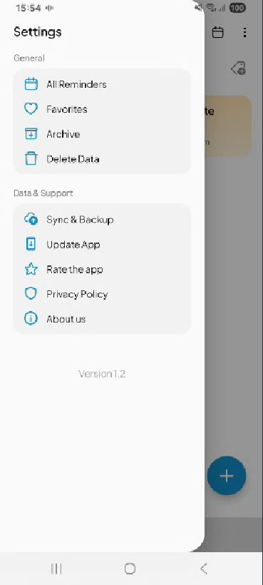

# Smart-Notes
Smart Note App(Cloud based - Canvas - Widgets - Voice Recording - pdf conversion - lock - images support)

## 📝 Core Features

* **Rich Notepad & Modular Note Blocks:**
  * **Checklists & Todo Lists:** Interactive task lists and checklist items built directly into notes.
  * **Image Uploading & Gallery:** Insert and manage multiple images/photos inside notes.
  * **Voice Notes / Audio Recording:** Record, save, and play back voice notes / audio memos directly within the notepad.
  * **File Attachments:** Attach files of various formats with file names and size details to your notes.

* **Export & Sharing Capabilities:**
  * **Share as PDF:** Export and share notes directly as formatted PDF documents.
  * **Share as Image:** Share your notes easily as image snapshots.

* **Canvas / Sketching Mode:**
  * Built-in drawing canvas supporting freehand sketching, customizable tool types, background images, and active stroke paths.

* **Category Organization:**
  * Create, edit, and filter notes using custom color-coded categories.

* **Favorites & Archiving:**
  * Quickly pin important notes to favorites or move completed/old notes to the Archive.

* **Calendar & Reminders:**
  * Integrated calendar view and reminder management to keep track of schedules and notes by date.

* **Cloud Backup & Sync:**
  * Secure backup and sync with Google Drive using Google Sign-In and Google APIs.

* **Home Screen Widgets:**
  * Quick-access interactive home screen widgets powered by Jetpack Glance (Material 3).


## 🛠️ Tech Stack

* **Language:** Kotlin 2.x (JVM Target 21)
* **UI Framework:** Jetpack Compose & Material 3 (with Edge-to-Edge support)
* **Architecture:** MVVM (Model-View-ViewModel) with Repository Pattern
* **Dependency Injection:** Dagger Hilt & Hilt WorkManager integration
* **Local Database:** Room Database (2.7.1) with Coroutines and Flows
* **Asynchronous Programming:** Kotlin Coroutines & Flow (1.8.1)
* **Navigation:** Jetpack Navigation Compose (2.7.7)
* **Widgets:** Jetpack Glance AppWidget (1.1.0)
* **Cloud & Authentication:** Google Play Services Auth & Google Drive API v3
* **Image Loading:** Coil Compose (2.5.0)
* **Data Serialization:** Gson & Kotlinx Serialization
* **Background Tasks:** Android WorkManager (2.9.0)

## 📂 Project Structure

```text
com.example.smart.notes/
│
├── data/
│   ├── enumclass/          # Enum types (e.g., CanvasToolType)
│   ├── local/              # Room database setup, entities, and DAOs
│   │   ├── dao/            # CategoryDao, NoteDao, SyncInfoDao
│   │   ├── dataclasses/    # Canvas data classes & active paths
│   │   └── entity/         # CategoryEntity, NoteEntity, SyncInfoEntity
│   ├── repository/         # NoteRepository, CategoryRepository, SyncRepository
│   └── sealedclasses/      # Note blocks (Text, Images, Voice, Checklist, Attachment), serializers, and backgrounds
│
├── di/                     # Dependency Injection modules (DatabaseModule, etc.)
│
├── ui/
│   ├── feature/
│   │   ├── components/     # Reusable UI components (Notepad, Canvas, Calendar widgets)
│   │   └── screens/        # App screens (Home, Notepad, Canvas, Calendar, Archive,
│   │                       #              Favorites, ManageCategory, SyncBackup, Widget, etc.)
│   ├── navigation/         # NavRoutes & AppNavGraph
│   ├── theme/              # Material 3 Theme, Color, Type, and Fonts
│   └── viewmodel/          # NoteViewModel, CategoryViewModel, SyncViewModel
│
├── EasyNotesApp.kt         # Application class (@HiltAndroidApp)
└── MainActivity.kt         # Main Activity entry point


## 📱 Requirements & System Specifications

* **Minimum SDK:** API 24 (Android 7.0 Nougat)
* **Target SDK:** API 37
* **Compile SDK:** API 37
* **Java Version:** Java 21 (JDK 21 required for building)
* **Gradle Version:** Compatible with Android Gradle Plugin (AGP) and Gradle wrapper configured in the project.
* **Google Play Services:** Required on the device for Google Drive backup and sign-in functionality.

## App Screenshots






